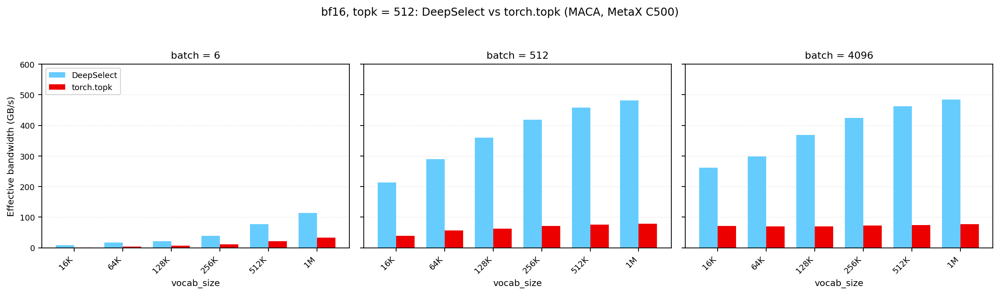
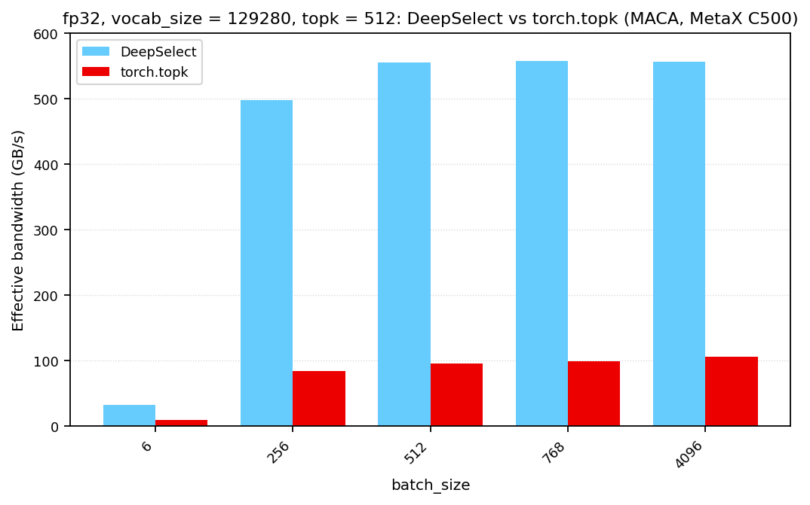

# DeepSelect

DeepSelect is a high performance implementation of the TopK kernel used in DeepSeek Sparse Attention (DSA) (which is used in DeepSeek V3.2, DeepSeek V4, and DeepSeek V4.1 models) and the sampler. It supports NVIDIA CUDA, Huawei Ascend and MetaX MACA platforms, and achieves 2 ~ 20x speedup compared to vanilla `torch.topk`.

This repository is the **MetaX MACA** implementation, for the C500 / C600 / C600U parts. The public Python signature is upstream's, parameter for parameter, plus `backend=` and `check_nan=` appended after upstream's last argument, so an upstream call site works here unchanged.

DeepSelect 是为 DeepSeek 稀疏注意力（DeepSeek Sparse Attention, DSA）和采样器（Sampler）定制的高性能 TopK 算子，支持 NVIDIA CUDA、华为昇腾（Ascend）与 MetaX MACA（C500 / C600 / C600U）平台。本仓库是 MetaX MACA 实现。与原生 `torch.topk` 相比，它可实现 2～20 倍的加速。

## News

- 2026.10.25: We've released TopK kernels for MetaX MACA (C500 / C600 / C600U)
- 2026.09.30: We've released TopK kernels for Huawei Ascend NPU
- 2026.09.10: We've released a brief analysis of the algorithm and its implementation: [English](docs/DeepSelect-deep-dive.md) | [中文](docs/DeepSelect-deep-dive.zh.md)
- 2026.09.10: We've released DeepSelect v1.0.0

## Supported Cases

TopK workloads vary widely, and the fastest algorithm & implementation highly depends on the input dtype, `batch_size`, `vocab_size`, and `topk`. This repository only focuses on the following cases:

### Lightning Indexer Scenario

This scenario covers:
- Input dtype: `torch.bfloat16`
- `batch_size`: $1 \sim +\infty$ (both large and small batch sizes are optimized)
- `vocab_size`: $1 \sim +\infty$ (both large and small vocabularies are optimized)
- `topk`: small (must be $\le 4096$; larger values are not supported), mainly optimized for `topk=512` (i.e., DeepSeek V4's `topk`)

Recommendations:
- Disable `sorted_index` unless the output has to be ordered by index; enabling it costs performance.
- Set `return_value=False` when the values are not needed. This skips the value output and is faster.

### Sampling Scenario

This scenario covers:
- Input dtype: `torch.float32`
- `batch_size`: $1 \sim +\infty$
- `vocab_size`: around 128K
- `topk`: small (must be $\le 4096$; larger values are not supported)

The MetaX MACA implementation supports both `torch.bfloat16` and `torch.float32`.

## Performance

Measured with the benchmark in [`tests/test.py`](tests/test.py)
(`python3 tests/test.py --perf-only`), which reports the ratio against `torch.topk`
on the same input. The metric is effective memory bandwidth: TopK does no
floating-point math, so a FLOP rate would not be meaningful here.

Each C600 figure names the commit it was measured on, because the boards were not
all measured on the same one, and the C500 pair is older than both. Every figure
is rendered from a recording committed under `perf_data/<board>/<timestamp>/`,
whose manifest carries the device, the source commit and the artifact md5.

### Lightning Indexer Scenario (MetaX MACA)

bfloat16, `topk = 512`, one subplot per batch size.

MetaX C500 (104 AP):



MetaX C600-A (32 AP), measured on `ef57dcc` (2026-10-24, artifact `4cdaee40f496`):


MetaX C600-U (28 AP), measured on `73f8fcb` (2026-10-26, artifact `2bc99c719dd8`):


### Sampling Scenario (MetaX MACA)

float32, `vocab_size = 129280`, `topk = 512`.

MetaX C500 (104 AP):



MetaX C600-A (32 AP), measured on `ef57dcc` (2026-10-24, artifact `4cdaee40f496`):


MetaX C600-U (28 AP), measured on `73f8fcb` (2026-10-26, artifact `2bc99c719dd8`):


## Installation

Requires a MACA toolkit (`MACA_PATH`) and the MACA-compatible PyTorch build.

```bash
# from a checkout of this MACA fork
./install.sh
```

`./install.sh` builds the wheel for this machine's device and installs it. `./build.sh` builds a wheel carrying every MACA family (C500, C600, C600U); `./develop.sh` builds the in-place extension. `pip install .` is not supported here.

## Usage

```python
import torch
import deep_select

# input: (batch_size, vocab_size), torch.bfloat16 or torch.float32.
# Its row stride must be a multiple of `deep_select.get_stride_requirement()[0]` bytes, and its last dimension must be contiguous.
batch_size, vocab_size, topk = 4, 204800, 1024

x = torch.randn(batch_size, vocab_size, dtype=torch.bfloat16, device="cuda")

values, indices = deep_select.topk(
    x,
    topk,
    sorted=False,              # sort the result by values in descending order
    sorted_index=True,         # return each row's indices in ascending order
    indices_type=torch.int32,  # torch.int32 or torch.int64
    return_value=True,         # False skips the value output (~10% faster)
)
# values:  (batch_size, topk) of x.dtype
# indices: (batch_size, topk) of indices_type
```

The row stride of the input tensor (`x`) must be aligned to `deep_select.get_stride_requirement()[0]` bytes. For unaligned inputs, padding is necessary.

Both outputs are allocated by the call, and their strides are aligned to `deep_select.get_stride_requirement()[1]` bytes (so they may be non-contiguous). Pass `output_idx=` to write indices into a buffer you own, and that buffer must satisfy the same stride requirement.

For the full signature, see [`deep_select/interface.py`](deep_select/interface.py).

### Backends

`backend=` selects the implementation: `"maca_c"` (the default) is the MACA kernel, `"torch"` is the reference implementation. A call with no `backend=` follows `DS_TOPK_BACKEND`, so the reference is asked for by naming it (`backend="torch"` or `DS_TOPK_BACKEND=torch`); a bare call runs the kernel, which is the only behaviour upstream's CUDA API has.

### Variable-length rows

`end` sets a per-row upper bound (exclusive). Rows shorter than `topk` are padded with
`value_oob_fill_value` / `idx_oob_fill_value`:

```python
batch_size, vocab_size = 2, 129280   # 129280 is a multiple of 256, so float32 is fine
x = torch.randn(batch_size, vocab_size, dtype=torch.float32, device="cuda")

end = torch.tensor([129280, 100000], dtype=torch.int32, device="cuda")  # (batch_size,)
values, indices = deep_select.topk(x, 1000, end=end, sorted=True,
                                   indices_type=torch.int64)
```

### NaN handling

NaN checking is on by default. With the default `abort_when_nan_found=True` the kernel invokes `trap()` and aborts; with `abort_when_nan_found=False` the row is flagged with `0x3F3F3F3F` in `output_idx[row, 0]` and the rest of the row is undefined. `check_nan=False` turns the scan off. Rows whose length is `<= topk` are never NaN-checked.

## Citation

```text
@misc{deepselect2026,
    title={DeepSelect: High-Performance TopK Kernels for DeepSeek Sparse Attention and Sampling},
    author={Yi Qian and Shengyu Liu and Yichen Li},
    year={2026},
    publisher = {GitHub},
    howpublished = {\url{https://github.com/deepseek-ai/DeepSelect}},
}
```
